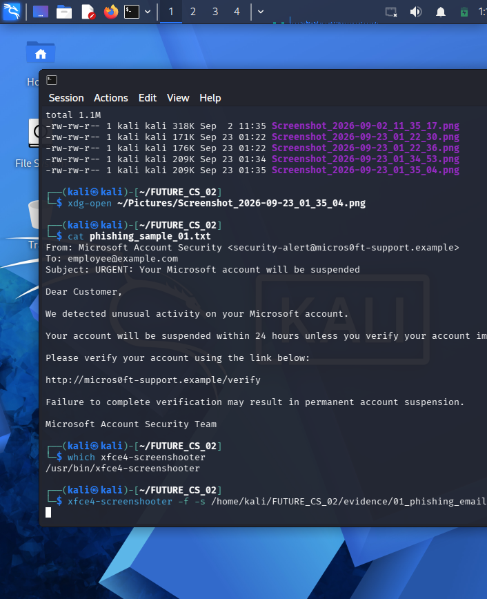
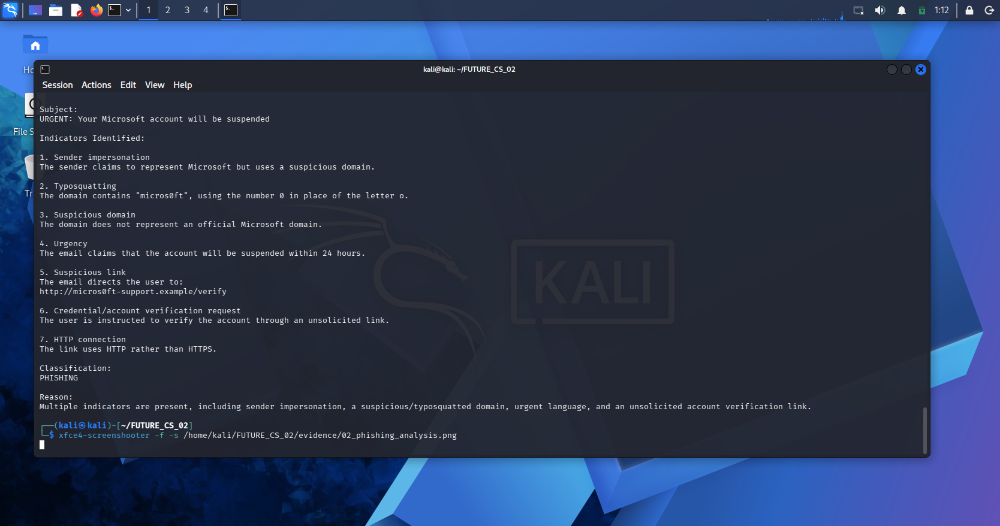

# FUTURE INTERNS

# CYBER SECURITY INTERNSHIP

## TASK 2: PHISHING EMAIL DETECTION & AWARENESS SYSTEM

**Name:** Satyakiran Mynam
**Internship:** Future Interns - Cyber Security
**Task ID:** FUTURE_CS_02
**Date:** October 2026

---

## 1. INTRODUCTION

Phishing is a common social-engineering technique used by attackers to deceive users into revealing sensitive information such as usernames, passwords, financial information, or authentication codes.

The purpose of this task is to analyze a simulated phishing email, identify common phishing indicators, classify the email, and provide security awareness and prevention guidelines.

---

## 2. OBJECTIVE

The objectives of this task are:

* Identify phishing indicators in suspicious emails.
* Analyze sender information and domains.
* Identify suspicious or malicious-looking URLs.
* Detect social-engineering techniques such as urgency and fear.
* Classify an email as Safe, Suspicious, or Phishing.
* Explain phishing risks in business-friendly language.
* Provide practical phishing prevention and awareness guidelines.

---

## 3. TOOLS AND TECHNIQUES USED

The following tools and techniques were used:

* Kali Linux
* Linux Terminal
* Email analysis techniques
* Sender and domain analysis
* URL analysis
* Browser-based inspection concepts
* Markdown documentation
* Pandoc PDF generation
* XFCE Screenshot Utility

---

## 4. METHODOLOGY

The simulated phishing email was analyzed using the following process:

1. Review the sender email address.
2. Examine the sender domain.
3. Analyze the subject line.
4. Review the message content.
5. Inspect URLs contained in the email.
6. Identify urgency, fear, or pressure-based language.
7. Identify requests for account verification or credentials.
8. Check whether the URL uses HTTP or HTTPS.
9. Identify multiple phishing indicators.
10. Classify the email based on the collected evidence.

---

## 5. SAMPLE EMAIL ANALYSIS

### Sample Type

**Simulated/Test Phishing Email**

### Sender

`Microsoft Account Security <security-alert@micros0ft-support.example>`

### Recipient

`employee@example.com`

### Subject

**URGENT: Your Microsoft account will be suspended**

### Message Summary

The email claims that unusual activity has been detected on the recipient's Microsoft account.

It creates urgency by stating that the account will be suspended within 24 hours unless the recipient verifies the account immediately.

The message provides a link requesting account verification.

### Suspicious URL

`http://micros0ft-support.example/verify`

---

## 6. PHISHING INDICATORS IDENTIFIED

| No. | Indicator                    | Observation                                                                   | Risk   |
| --- | ---------------------------- | ----------------------------------------------------------------------------- | ------ |
| 1   | Sender Impersonation         | Sender claims to represent Microsoft but uses a suspicious domain.            | High   |
| 2   | Typosquatting                | `micros0ft` uses the number `0` instead of the letter `o`.                    | High   |
| 3   | Suspicious Domain            | The domain does not represent an official Microsoft domain.                   | High   |
| 4   | Urgency                      | The email threatens account suspension within 24 hours.                       | Medium |
| 5   | Suspicious Link              | The message directs the user to an unfamiliar verification URL.               | High   |
| 6   | Account Verification Request | The recipient is instructed to verify an account through an unsolicited link. | High   |
| 7   | HTTP Connection              | The URL uses HTTP instead of HTTPS.                                           | Medium |

---

## 7. DETAILED ANALYSIS

### 7.1 Sender Impersonation

The sender claims to represent Microsoft Account Security.

However, the email address uses:

`security-alert@micros0ft-support.example`

The domain is suspicious and does not represent an official Microsoft service.

This is a common phishing technique where an attacker attempts to appear as a trusted organization.

### 7.2 Typosquatting

The domain contains:

`micros0ft`

The number `0` has been substituted for the letter `o`.

This is known as typosquatting or look-alike domain abuse. Attackers may use visually similar domains to make fraudulent addresses appear legitimate.

### 7.3 Urgency and Fear

The subject states:

**"URGENT: Your Microsoft account will be suspended"**

The email also claims that the account will be suspended within 24 hours.

Creating urgency can pressure users into acting without carefully checking the sender or URL.

### 7.4 Suspicious Link

The email contains:

`http://micros0ft-support.example/verify`

The domain is suspicious and does not represent an official Microsoft domain.

Users should avoid opening unexpected links and should instead navigate directly to the official website or application.

### 7.5 Account Verification Request

The recipient is asked to verify an account using an unsolicited link.

Unexpected requests for account verification should be treated cautiously, particularly when they involve urgent deadlines or unfamiliar domains.

### 7.6 HTTP Usage

The URL begins with:

`http://`

rather than:

`https://`

The use of HTTP does not by itself prove that a message is phishing, but it is an additional warning sign when combined with an unfamiliar domain and an unsolicited verification request.

---

## 8. CLASSIFICATION

### FINAL CLASSIFICATION: PHISHING

The email is classified as **PHISHING** because it contains multiple indicators, including:

* Sender impersonation
* Suspicious domain
* Typosquatting
* Urgent account suspension message
* Suspicious verification link
* Unsolicited account verification request
* HTTP URL

The combination of these indicators presents a strong phishing pattern.

---

## 9. SECURITY AWARENESS AND PREVENTION GUIDELINES

Organizations and users can reduce phishing risks by following these practices:

### 9.1 Verify the Sender

Always inspect the complete sender email address rather than relying only on the displayed sender name.

### 9.2 Check the Domain

Look carefully for:

* Misspellings
* Extra words
* Unexpected subdomains
* Replaced characters
* Look-alike characters

### 9.3 Avoid Suspicious Links

Do not click links in unexpected emails.

Instead, open the official website or application directly using a trusted bookmark or manually entered address.

### 9.4 Do Not Respond to Unexpected Verification Requests

Unexpected requests for passwords, account verification, authentication codes, or other sensitive information should be treated cautiously.

### 9.5 Be Careful With Urgent Messages

Messages that create pressure through deadlines, threats, account suspension, or fear should be independently verified.

### 9.6 Enable Multi-Factor Authentication

Multi-factor authentication can provide an additional layer of protection if account credentials are compromised.

### 9.7 Report Suspicious Emails

Users should report suspected phishing messages to their organization's security team or the appropriate reporting mechanism.

### 9.8 Conduct Security Awareness Training

Organizations should regularly train employees to recognize:

* Phishing
* Social engineering
* Suspicious links
* Sender impersonation
* Typosquatting
* Credential theft attempts

---

# 10. EVIDENCE

The following screenshots were captured during the analysis of the simulated phishing email.

## Evidence 1 — Simulated Phishing Email

The screenshot shows the simulated email, including the suspicious sender, urgent subject, message content, and verification link.

**Figure 1: Simulated phishing email used for analysis.**

---

## Evidence 2 — Phishing Analysis

The screenshot shows the analysis of the phishing sample and the identified indicators.

**Figure 2: Phishing indicators and classification analysis.**

---

## 11. ORGANIZATIONAL RISKS

Successful phishing attacks can result in:

* Credential theft
* Unauthorized account access
* Identity compromise
* Malware infection
* Financial loss
* Data exposure
* Business email compromise
* Loss of customer trust
* Operational disruption

Organizations should combine technical controls with regular employee security awareness training.

---

## 12. RECOMMENDED SECURITY CONTROLS

Recommended controls include:

* Multi-factor authentication
* Email security filtering
* Anti-phishing protection
* Domain monitoring
* Secure web filtering
* User awareness training
* Phishing simulations
* Incident reporting procedures
* Strong password policies
* Regular security assessments

---

## 13. CONCLUSION

This task demonstrated how a suspicious email can be analyzed using sender information, domain analysis, URL inspection, message content, and social-engineering indicators.

The simulated email contained multiple characteristics commonly associated with phishing, including sender impersonation, typosquatting, urgency, an unfamiliar domain, and an unsolicited account verification request.

Recognizing these indicators can help users avoid phishing attacks and reduce the risk of credential theft and account compromise.

---

## 14. DISCLAIMER

The email analyzed in this project is a **simulated/test phishing sample created specifically for cybersecurity education and internship documentation**.

It is not a real Microsoft communication and was not used to target real users, collect credentials, access real accounts, or obtain personal information.

All analysis and evidence were created for educational and defensive cybersecurity purposes.

